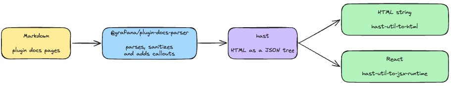

# @grafana/plugin-docs-parser

Lightweight library for parsing Grafana plugin documentation from markdown to HAST.

Plugin docs are plain markdown pages that ship with each plugin release. This package turns a page into a [HAST](https://github.com/syntax-tree/hast) tree with its frontmatter and headings, so a site can render it. The [Grafana plugin catalog](https://grafana.com/grafana/plugins/) uses it to show a plugin's Documentation tab, and [`@grafana/plugin-docs-cli`](https://github.com/grafana/plugin-tools/tree/main/packages/plugin-docs-cli) uses it for the local preview and validation.

Markdown goes in. You get the page's frontmatter, its headings and a sanitized HAST tree, which you render with `hast-util-to-html`, `hast-util-to-jsx-runtime` or your own components.



## Requirements

- Node.js 22 or later.
- An ES module environment. The package is ESM only.

## Installation

```bash
npm install @grafana/plugin-docs-parser
```

## Usage

```ts
import { parseMarkdown } from '@grafana/plugin-docs-parser';
import { toHtml } from 'hast-util-to-html';

const { frontmatter, hast, headings } = parseMarkdown(markdownContent);
const html = toHtml(hast);

// with CDN asset rewriting
const result = parseMarkdown(markdownContent, {
  assetBaseUrl: 'https://cdn.example.com/my-plugin/1.0.0/docs',
});
```

The parser returns a HAST tree and doesn't serialize it. Install the serializer you need, such as [`hast-util-to-html`](https://github.com/syntax-tree/hast-util-to-html) for an HTML string or [`hast-util-to-jsx-runtime`](https://github.com/syntax-tree/hast-util-to-jsx-runtime) for React.

## API

### `parseMarkdown(content, options?)`

Parses a markdown page, frontmatter included. It throws an `Error` when the frontmatter holds invalid YAML, and a `TypeError` when `assetBaseUrl` is a protocol-relative URL such as `//cdn.example.com`.

Options (`ParseOptions`):

| Option          | Type            | Description                                                                                                                                                                            |
| --------------- | --------------- | -------------------------------------------------------------------------------------------------------------------------------------------------------------------------------------- |
| `assetBaseUrl`  | `string`        | Base URL for relative image and asset paths. Must be an absolute URL or a root-relative path, not protocol-relative. When it isn't set, asset paths are left as written.               |
| `file`          | `string`        | The page's path relative to the docs root, such as `examples/azure.md`. Pass `Page.file` from the manifest. Relative images then resolve from the page's folder. Needs `assetBaseUrl`. |
| `snippetValues` | `SnippetValues` | Values from the plugin's `plugin.json`, so snippets can show the plugin's name and ID. See [Snippets](#snippets).                                                                      |

It returns (`ParsedMarkdown`):

| Field         | Type                      | Description                                                                                                                                      |
| ------------- | ------------------------- | ------------------------------------------------------------------------------------------------------------------------------------------------ |
| `frontmatter` | `Record<string, unknown>` | The page's frontmatter. It's an empty object when the page has none.                                                                             |
| `hast`        | `Root`                    | The page body as a HAST tree. Every `h1` is removed, because the title comes from the frontmatter.                                               |
| `headings`    | `Heading[]`               | The `h2` and `h3` headings, each with `text`, `level` and `id`, for a table of contents. Headings inside `<details>` and footnotes are left out. |

### What the parser renders

The parser accepts [CommonMark](https://commonmark.org/) and [GitHub Flavored Markdown](https://github.github.com/gfm/), and adds:

- callouts written as GitHub alerts, such as `> [!NOTE]`
- collapsible sections written with `<details>` and `<summary>`
- YouTube links and `.mp4` or `.webm` images, turned into elements a site can render as players
- syntax highlighting for fenced code blocks that name a supported language
- relative links to `.md` files, rewritten to clean page URLs

Raw HTML is limited to `br`, `details` (with `open`), `hr` and `summary` inside `details`. Any other HTML is dropped and its markdown content is kept, and the output is sanitized with [`rehype-sanitize`](https://github.com/rehypejs/rehype-sanitize).

Some of the output is meant for the site to style or replace:

| Markdown                                                       | Output                                                                                                                                            |
| -------------------------------------------------------------- | ------------------------------------------------------------------------------------------------------------------------------------------------- |
| `> [!NOTE]` and the other `CALLOUT_TYPES`                      | `<div class="callout callout-note" role="note">` with a `<p class="callout-title">` first.                                                        |
| A YouTube link alone in a paragraph, outside a list            | `<div class="youtube-embed" data-video-id="ID">` holding a link to the video. Build the player from `data-video-id`, or leave the link as it is.  |
| An image whose `src` ends in `.mp4` or `.webm`, outside a link | `<video>` with `controls`.                                                                                                                        |
| A fenced code block with a supported language                  | `<code class="hljs language-*">` with `hljs-*` spans. Load a [highlight.js](https://highlightjs.org/) theme to color it. Other blocks stay plain. |

For everything plugin authors can write, see [Supported markdown](https://github.com/grafana/plugin-tools/blob/main/packages/plugin-docs-cli/docs/supported-markdown.md).

### Helpers

| Export                         | Description                                                                                                                                  |
| ------------------------------ | -------------------------------------------------------------------------------------------------------------------------------------------- |
| `readSnippets(content)`        | Lists the snippets in a page with their line numbers, and the problems that make the page show its fallback text. See [Snippets](#snippets). |
| `SNIPPET_NAMES`                | The names of every snippet the parser knows.                                                                                                 |
| `getSnippetSource(name)`       | A snippet's markdown with its `{{placeholder}}` markers left in. Returns `undefined` for an unknown name.                                    |
| `renderSnippet(name, values?)` | A snippet's current markdown with the values filled in. Returns `undefined` for an unknown name or a missing value.                          |
| `CALLOUT_TYPES`                | The callout types the parser supports, mapped to their titles.                                                                               |
| `ALLOWED_HTML_TAGS`            | The raw HTML tags the parser keeps.                                                                                                          |
| `getYouTubeVideoId(url)`       | The video ID of a YouTube watch, `youtu.be`, embed or Shorts URL. Returns `undefined` for any other URL.                                     |

### Types

`Manifest`, `Page` and `Frontmatter` describe the `manifest.json` that `plugin-docs-cli build` writes. `MarkdownFiles` maps a docs file's path to its content. `Heading`, `ParsedMarkdown`, `ParseOptions`, `SnippetValues`, `SnippetLocation`, `SnippetProblem`, `SnippetName` and `CalloutType` describe what the functions take and return.

## Snippets

A snippet is shared text that the parser keeps current. In a page, the text between `<!-- snippet:<name> -->` and `<!-- /snippet:<name> -->` is a fallback, and the parser replaces it with the snippet's current text. Pass `snippetValues` with the fields from the plugin's `plugin.json`, so snippets that show the plugin's name or ID can render:

```ts
const result = parseMarkdown(markdownContent, {
  snippetValues: { pluginName: 'My data source', pluginId: 'myorg-my-datasource' },
});
```

Values are filled in as plain text, so markdown in a plugin name isn't formatted.

A page keeps its fallback text when the parser doesn't know a snippet, when a value the snippet needs is missing or when the page's markers have a problem, such as a marker without its pair or a heading inside a snippet. `readSnippets` reports those problems. For how authors use snippets, see [Snippets](https://github.com/grafana/plugin-tools/blob/main/packages/plugin-docs-cli/docs/snippets.md). So:

- Snippets are add-only. A snippet's text can change, but its name is never renamed or removed.
- Sites that render plugin docs update the parser before `create-plugin` scaffolds a new snippet. If one doesn't, the fallback text covers the gap.

## Related packages

- [@grafana/plugin-docs-cli](https://github.com/grafana/plugin-tools/tree/main/packages/plugin-docs-cli) previews, validates and builds plugin docs.
- [@grafana/create-plugin](https://github.com/grafana/plugin-tools/tree/main/packages/create-plugin) scaffolds plugin docs with `add docs`.

## Contributing

We welcome contributions. See the [contributing guide](https://github.com/grafana/plugin-tools/blob/main/packages/plugin-docs-parser/CONTRIBUTING.md) to get started.

## License

[Apache 2.0](https://github.com/grafana/plugin-tools/blob/main/packages/plugin-docs-parser/LICENSE)
